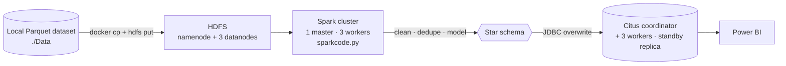
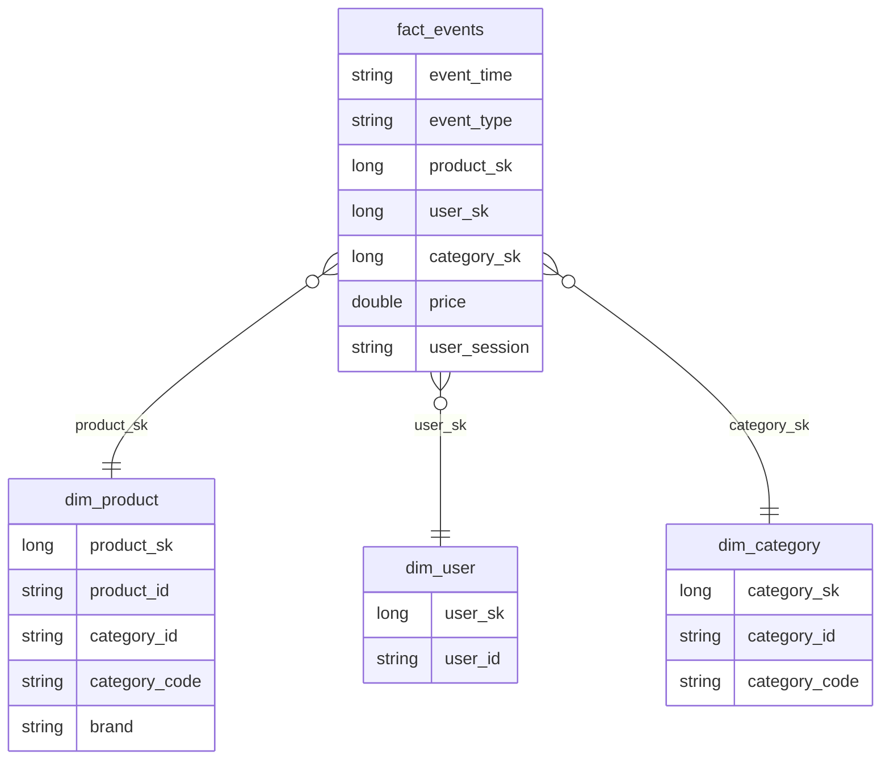

<div align="center">

# 🛒 E-commerce Big Data Pipeline

**Batch ETL from HDFS to a distributed Citus/PostgreSQL star-schema warehouse with Spark — ready for BI dashboards.**


</div>

---

## 📌 Overview

This project shows an end-to-end **batch data-engineering workflow** for e-commerce event data (views, carts, purchases): raw Parquet files are stored in **HDFS**, cleaned and modelled by an **Apache Spark** job, and loaded through JDBC into a **Citus** (distributed PostgreSQL) warehouse. The curated tables can then be explored from Power BI.

Everything runs locally with Docker Compose: a Hadoop cluster, a Spark standalone cluster and a Citus cluster with a standby replica.

## 🧭 Architecture



| Layer | Image / tool |
|---|---|
| Storage | `bde2020/hadoop-namenode` + 3 × `hadoop-datanode` (Hadoop 3.2.1), YARN resourcemanager / nodemanager, history server |
| Processing | `bde2020/spark-master` + `spark-worker` (Spark 3.3.0, scaled to 3 workers) |
| Warehouse | `citusdata/citus:13.0.3` coordinator, 3 workers, membership manager, streaming-replication standby |

## 🧱 Data Model

[`sparkcode.py`](./sparkcode.py) builds a star schema with surrogate keys (`monotonically_increasing_id`):



## 🔧 ETL Steps

1. Read Parquet from `hdfs://namenode:9000/user/root/nader/data/tmpdata/*.parquet`.
2. Drop rows with nulls, trim string columns, remove duplicates.
3. Normalise column names to `lower_snake_case`; strip non-ASCII characters; unify dates to `yyyy-MM-dd`.
4. Build `dim_product`, `dim_user`, `dim_category` and the `fact_events` table with foreign keys.
5. Write the four tables to Citus over JDBC (`mode("overwrite")`).

## 🗂️ Expected Input

> ⚠️ **Dataset not documented.** This repository does not name, ship or license the dataset it was built for. Use a dataset you are allowed to use, and check its licence before redistributing any data or derived tables.

A local folder of Parquet files with (at least) these columns: `event_time, event_type, product_id, category_id, category_code, brand, price, user_id, user_session`.

<!-- CONFIRM: dataset name/source. The schema matches the public "eCommerce behavior data from multi-category store" dataset (REES46 / Kaggle) — please confirm before citing. -->

## 🚀 Run

```bash
chmod +x start.sh
./start.sh                       # expects ./Data
DATA_DIR=/path/to/Data ./start.sh
```

`start.sh` starts the stack (`--scale worker=3 --scale spark-worker=3`), waits for HDFS to leave safe mode, uploads the data, installs the PostgreSQL JDBC driver in Spark and runs `spark-submit sparkcode.py`.

| Service | Address |
|---|---|
| HDFS Namenode UI | http://localhost:9870 |
| Spark Master UI | http://localhost:8080 |
| Citus coordinator | `localhost:55432` |
| Citus standby | `localhost:55433` |

Connect Power BI (or any PostgreSQL client) to `localhost:55432`, database `postgres`, and import the four tables.

```bash
docker compose ps          # status
docker compose down -v     # stop and remove volumes
```

> 🔐 **Local-lab configuration only.** `start.sh` exports `POSTGRES_PASSWORD=admin`, and `init.sh` sets `pg_hba` entries to `trust` for `0.0.0.0/0`. Do not expose these ports or reuse this setup outside a local environment; use secrets and restricted network rules in any shared deployment.

## 🔌 Power BI / BI Connection

After the ETL finishes, connect Power BI Desktop (or any PostgreSQL client) to the Citus coordinator — host `localhost`, port `55432`, database `postgres`, user `postgres`, password = the value exported by `start.sh` (a lab default; change it) — and import `dim_product`, `dim_user`, `dim_category` and `fact_events`.

## ✅ Verification Status

The Hadoop / Spark / Citus stack was **not started** here (it needs a large local Parquet dataset and several GB of images); the description comes from `docker-compose.yml`, `start.sh` and `sparkcode.py`.

## 📈 Dashboard Ideas (Power BI)

Event count by category · top brands by interactions · user activity over time · price distribution · conversion-style analysis by event type (view → cart → purchase).

## 🎓 What This Project Demonstrates

- Distributed storage (HDFS), distributed processing (Spark) and a distributed SQL warehouse (Citus) wired together with Docker Compose.
- Data cleaning and dimensional modelling (star schema with surrogate keys).
- Hand-off of curated tables to a BI tool.


## 👤 Author

**Nour Ghribi** · [GitHub](https://github.com/Nour-Ghribi)
